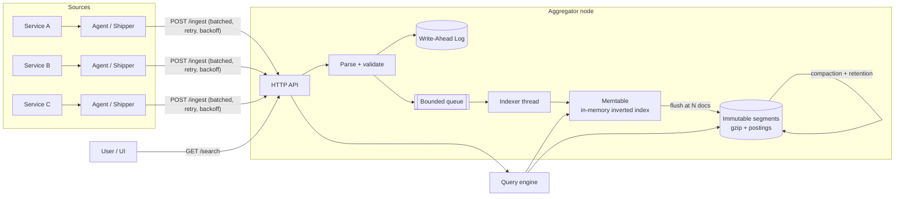

# logagg: Log Aggregator & Indexer

A small but complete **log aggregation and indexing system**, built as a System Design micro project.
Services ship logs to a central aggregator, which durably stores them, builds an **inverted index**, and
makes them searchable in milliseconds (like a miniature Elasticsearch / Loki / Splunk).

* Pure Python 3.10+ standard library: **no dependencies to install**
* Durable ingestion (write-ahead log), back-pressure, background indexing
* LSM-style segments, compaction, retention, time-range segment pruning
* Query language with AND / OR / NOT, phrases, prefix, field filters, TF-IDF ranking
* REST API + built-in web search UI + log shipper agent + tests + benchmark

Full design write-up (requirements, capacity estimates, trade-offs, scaling): **[docs/DESIGN.md](docs/DESIGN.md)**

## Architecture



**Write path:** parse → assign ID → append to WAL (durable) → `202 Accepted` → queue → indexer → memtable → flush to segment.
**Read path:** parse query → prune segments by time → search memtable + segments → merge → rank → paginate + facets.

## Quick start

```bash
git clone <your-repo-url> && cd log-aggregator

# 1. start the server (UI at http://127.0.0.1:8080)
python -m logagg --port 8080 --data-dir data

# 2. in another terminal, send synthetic traffic (200 logs/s)
python -m logagg.agent --generate --rate 200

# 3. search
curl "http://127.0.0.1:8080/search?q=timeout+level:error&limit=5"
```

Open <http://127.0.0.1:8080> for the search UI. Docker: `docker build -t logagg . && docker run -p 8080:8080 logagg`.

## Query language

| Query | Meaning |
|---|---|
| `timeout gateway` | both words (implicit AND) |
| `"connection refused"` | exact phrase |
| `pay*` | prefix match |
| `-healthcheck` | exclude documents containing the word |
| `level:error service:payment-service host:node-1` | field filters |
| `timeout OR deadlock` | union of two groups |
| `level:error -healthcheck pay* OR service:auth` | combine freely |

Extra params: `from`, `to` (epoch seconds or ISO-8601), `limit` (max 500), `offset`, `sort=time|relevance`.

## API

| Endpoint | Description |
|---|---|
| `POST /ingest` | JSON object, JSON array, `{"logs":[...]}`, or `text/plain` (one line per log). Returns `202`; `429` + `Retry-After` when the queue is full; `401` if `--api-key` is set and `X-API-Key` is missing or wrong (for ingestion and flush). Max 1000 logs/request. |
| `GET /search` | Returns `total`, `took_ms`, `facets` (level/service counts), `segments_searched/skipped`, and `results`. |
| `GET /stats` | Documents, segments, queue depth, WAL size, counters. |
| `POST /flush` | Force the memtable to disk (demo/testing); requires `X-API-Key` when API-key protection is enabled. |
| `GET /health` | Liveness probe. |

Log record fields: `message` (required), `service`, `level` (DEBUG/INFO/WARN/ERROR/FATAL), `host`, `ts` (epoch s/ms or ISO-8601, default = now).
Plain text lines like `2026-11-11T10:00:00Z ERROR [payment-service] Timeout calling gateway` are parsed automatically.

```bash
curl -X POST localhost:8080/ingest -H 'Content-Type: application/json' \
  -d '[{"service":"auth","level":"ERROR","message":"token verification failed","host":"node-1"}]'
```

## Server options

`--port`, `--data-dir`, `--flush-threshold` (docs per segment, default 2000), `--queue-size` (default 10000),
`--retention-hours`, `--max-segments` (default 6), `--fsync` (fsync WAL per batch), `--api-key` (or `LOGAGG_API_KEY`).

## Project structure

```
logagg/
  models.py      LogEntry + parsing of JSON / text input
  tokenizer.py   shared tokenizer (index time and query time)
  query.py       query-language parser
  index.py       Segment: inverted index, search, TF-IDF, persist/load/merge
  wal.py         write-ahead log (append, replay, truncate)
  engine.py      ingestion, indexer thread, flush, compaction, retention, search
  server.py      HTTP API + CLI entry point
  agent.py       log shipper / synthetic generator
  web/index.html search UI
tests/           unit + integration tests (13)
scripts/benchmark.py
docs/DESIGN.md  full system design document
```

## Tests and benchmark

```bash
python -m unittest discover -s tests -v
python scripts/benchmark.py 50000
```

Sample result on a laptop-class machine (single process): about **20k logs/s** ingest+index, and common queries over 20k docs in roughly **1-5 ms**.

## Known limitations (and how production systems solve them)

Single node, segments held in memory, JSON segment format, per-segment IDF, no auth beyond a shared key.
See the "Scaling" and "Trade-offs" sections of [docs/DESIGN.md](docs/DESIGN.md).

## License

MIT
